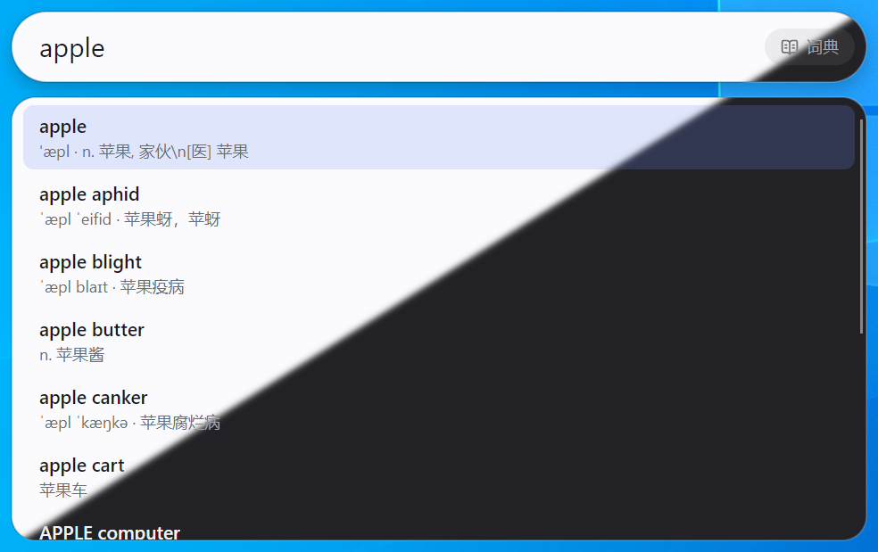

Read this in other languages: **简体中文**, [English](README.en-US.md)

<br>
<div align="center">
  
</div>
<br>

# 酥脆搜索（Crispy Searchbar）

一款轻量、现代、快速的 Windows 全局搜索框。使用 C# 与 Avalonia UI 构建，以响应迅速、后台低占用、搜索模式分离为设计目标。

此项目**没有**制作任何整合搜索或全量搜索模式的打算，而是致力于为有确定搜索或查询意图、不愿意被无关搜索结果干扰的用户打造。

## 功能特色

<br>
<div align="center">
  
</div>
<br>

- **快速呼出**：常驻于系统托盘，按下快捷键（默认为 Alt + 空格键）即可呼出搜索框。
- **开机自启**：可在设置中启用登录 Windows 后自动启动，并静默驻留系统托盘。
- **全屏免打扰**：默认在前台应用全屏时不响应全局快捷键，避免打断游戏或视频；托盘点击仍可随时呼出。
- **模式切换**：短按模式切换键（默认为 Tab）快速切换到下一搜索模式（保留输入内容）；长按模式切换键呼出模式选择轮盘，并可以用 ↑、↓ 键或鼠标滚轮进行切换。
- **模式自定义**：用户可随时在配置设置面板中启用或禁用任意搜索模式，并可对各个模式在切换轮盘中的位置进行拖拽排序。
- **位置可调**：搜索框默认出现在主显示器中央，可在设置面板中调整位置偏移；搜索框靠近屏幕底部时，候选框与模式轮盘会自动改为向上弹出。
- **跟随系统主题**：支持浅色/深色模式，并可根据系统主题自动跟随切换。

## 支持搜索模式

- **网页搜索**：使用预先配置的搜索引擎在默认浏览器中搜索输入的内容，支持[百度](https://www.baidu.com)、[谷歌](https://www.google.com/)和[必应](https://www.bing.com/)。
- **维基百科**：在 [维基百科](https://zh.wikipedia.org/) 中查询输入的内容，所使用的维基百科语种将随界面语言自动切换。
- **询问 Deepseek**：使用默认浏览器，在 [DeepSeek 网页版](https://chat.deepseek.com/) 中询问输入的问题。需要用户拥有 DeepSeek 账户并提前在浏览器中登录。
- **词典**：支持英汉和汉英词汇查询，随输入实时显示候选词。使用 [CC-CEDICT](https://www.mdbg.net/chinese/dictionary?page=cedict)（汉 → 英）与 [ECDICT](https://github.com/skywind3000/ECDICT)（英 → 汉）进行离线查询。离线词典数据随程序本体一同分发（内嵌在 exe 内），无需另外下载。用户可以自行下载第三方词典源并进行配置，支持以下词典格式：`.txt`（CC-CEDICT 文本，或每行“词头 + 制表符 + 释义”的通用文本）、`.csv`、`.gz`/`.zip` 压缩文件，以及 [StarDict](https://en.wikipedia.org/wiki/StarDict) 词库（`.ifo`，需同目录配套 `.idx` 与 `.dict`/`.dict.dz`）；解析方向由你把它填在“汉英”还是“英汉”设置项决定。当前版本暂不支持更多语种词典。

### Emoji 模式

设置 → 外观 → Emoji 候选样式可切换“列表”（默认）或“网格”。网格按九种分类浏览全部 Emoji，另有“最近使用”页签；输入后该页签变为“搜索结果”并自动选中，各分类只展示匹配项。没有使用记录时默认打开表情分类。网格中 ←/→ 逐项选择，↑/↓ 按行选择，Alt+←/→ 切换分类。

按 **Win+.** 直接呼出，或通过 Tab 切换到 Emoji。支持英文、中文、全拼、首字母与有限错拼，例如 `smile`、`weixiao`、`wx`、`点赞`、`dz`。↑/↓ 选择，Enter 或点击输入原应用；默认输入后关闭，可在设置中开启连续输入。

- `Alt+↓` 选择肤色变体，Enter 确认，Esc 返回；默认肤色可配置。
- `Ctrl+Shift+C` 复制 Emoji；默认直接 Unicode 输入不修改剪贴板。特殊应用或管理员窗口可使用复制后手动粘贴。
- 最近使用记录保存在 `%LOCALAPPDATA%\CrispySearchbar\emoji-history.json`，不记录查询或目标窗口。
- 内嵌 Unicode Emoji 17.0、CLDR 48 与 Twemoji 17.0.3，离线可用。预览图案与目标应用实际显示风格可能不同。
- 数据更新：用 `python -m pip install --require-hashes -r scripts/emoji-requirements.txt` 安装固定版本生成工具，再执行 `python scripts/generate-emoji.py`；来源锁与 SHA-256 在 `scripts/emoji-sources.lock.json`，产物摘要在 `scripts/emoji-manifest.json`。只有主动更新来源时才使用 `--refresh-lock`。

## 环境要求

- Windows 10 x64

## 安装使用

本应用被设计为自包含、便携式的单 .exe 文件，下载后放入任意目录双击打开即可使用，无需额外安装步骤。

配置保存在 `%APPDATA%\CrispySearchbar\settings.json`，程序目录不会生成配置或历史文件。升级时会自动迁移旧配置，先备份再清理旧文件；备份位于用户配置目录的 `backups` 子目录。

## 构建与人工审查

开发环境需要 .NET 10 SDK、PowerShell 7 和 Git。在仓库根目录执行：

```powershell
dotnet test CrispySearchbar.sln
pwsh ./scripts/publish-portable.ps1
```

发布脚本按当前发布标准生成 win-x64 自包含的单文件 Portable 应用，默认保存到
`artifacts/<当前 HEAD 的短 Commit 编号>/crispy-searchbar-{version}-win-x64.exe`
（例如 `artifacts/086697c/crispy-searchbar-0.1.0-win-x64.exe`），并输出文件大小与 SHA-256。
版本号默认从项目文件读取，也可通过 `-Version` 指定；`-OutputDirectory` 可覆盖最终输出目录，相对路径以仓库根目录为基准。

每次任务完成后（包括仅修改文档或配置），均须生成最新应用供人工审查。
有改动时先完成必要验证并创建本地提交，再针对最终 HEAD 执行发布脚本；仅运行 `dotnet build` 或测试不能代替发布。
脚本构建当前工作区内容，不会自动提交或切换到 HEAD；人工审查产物应对应已提交的代码。
审查时直接运行对应 Commit 目录中的 exe。`artifacts/` 已被 Git 忽略，无需提交产物。

## 仓库结构

```text
src/CrispySearchbar/           Avalonia UI 应用（窗口、托盘、Windows 热键）
src/CrispySearchbar.Core/      与平台无关的核心（设置、模式、URL 构建、词典索引）
tests/CrispySearchbar.Core.Tests/  核心逻辑单元测试
licenses/                     集中存放的第三方许可证全文
assets/icon/                  应用图标源 PNG 与多尺寸 ICO 素材
locales/                      各语言界面翻译（见 locales/README.md）
data/cc-cedict/               内置 CC-CEDICT 数据（gzip，作为嵌入资源打包进程序）
data/ecdict/                  内置 ECDICT 数据（gzip，作为嵌入资源打包进程序）
scripts/publish-portable.ps1  便携单文件版发布脚本
```

## 许可证

项目代码采用 [MIT 许可证](LICENSE)；

第三方依赖与词典数据的许可证汇总见 [THIRD_PARTY_NOTICES.md](THIRD_PARTY_NOTICES.md)；

许可证全文集中存放于 `licenses/`。
